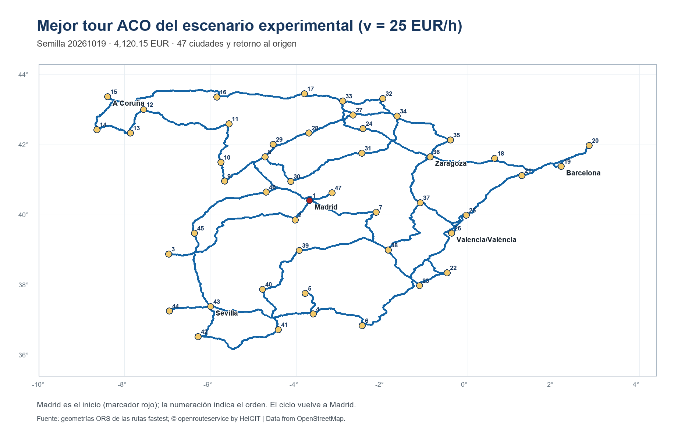
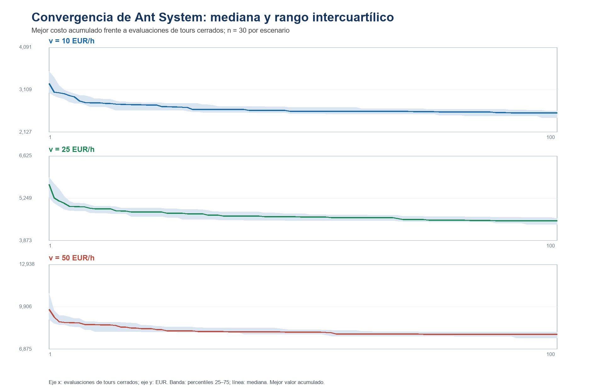
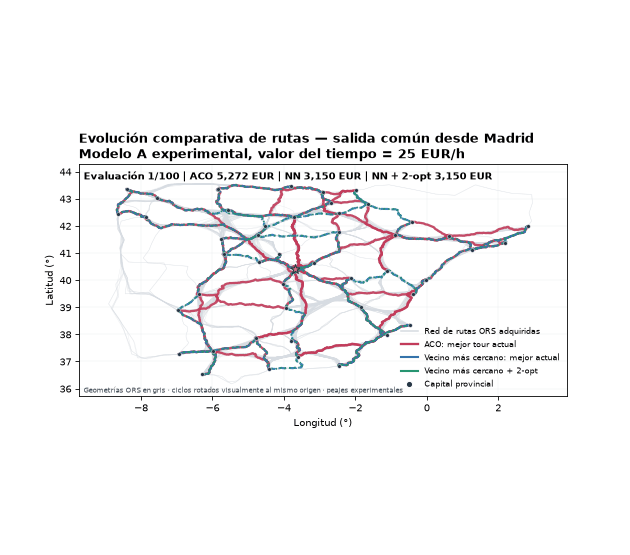
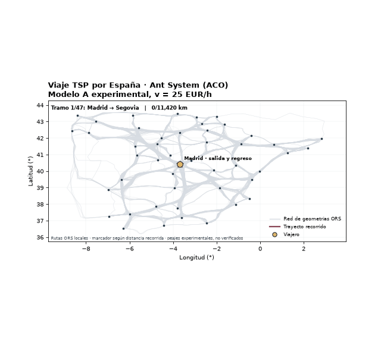
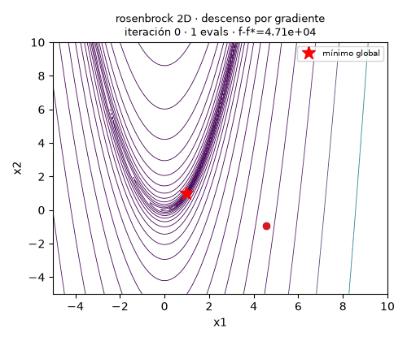
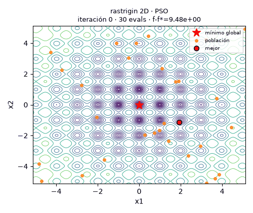

# Del gradiente a las hormigas: optimización numérica, metaheurística y combinatoria

**Trabajo 1 — Redes Neuronales y Algoritmos Bioinspirados**
Universidad Nacional de Colombia · Facultad de Minas · semestre 2026-02

## Integrantes

- Leonard David Vivas Dallos
- José Nicolás Duque Linares
- Sebastian Estrada Villa

## Propósito

El trabajo tiene dos partes. En la primera comparamos descenso por gradiente (GD), algoritmo evolutivo (EA), optimización por enjambre de partículas (PSO) y evolución diferencial (DE) en Rosenbrock y Rastrigin. En la segunda formulamos un TSP dirigido sobre 47 capitales provinciales de España peninsular y evaluamos ACO sobre costos por carretera.

El análisis TSP distingue el baseline publicado sin peajes del **Modelo A experimental**, que combina tiempo, combustible y peajes asumidos o estimados. El paquete económico no es un tarifario nacional certificado. Este snapshot no contiene implementación ni resultados de GA; no se atribuyen resultados de GA a ACO.

## Contenido del repositorio

| Ruta | Contenido |
|---|---|
| `src/` | Métodos numéricos, metaheurísticas, TSP y ETL |
| `experiments/` | Experimentos, validadores y orquestador de reproducción |
| `configs/` | Configuraciones versionadas de experimentos |
| `data/datasets/spain_tsp_2026/` | Catálogo, matrices base y 2.162 geometrías enriquecidas |
| `data/datasets/spain_tsp_economic_20261013/` | Matrices económicas experimentales y evidencia por arco |
| `data/reference/` | Fuentes de referencia seleccionadas |
| `results/` | Resultados numéricos versionados |
| `figures/` | Figuras y animaciones publicadas |
| `tests/` | Pruebas automatizadas |
| `docs/` | Metodología, datos, peajes y limitaciones |
| `informe/` | Plantilla y generador del informe final |

## Instalación

Se requiere Python 3.10 o posterior. Desde la raíz del repositorio:

```bash
python -m venv .venv
# Windows PowerShell
.venv\Scripts\Activate.ps1
# macOS/Linux: source .venv/bin/activate
python -m pip install -r requirements.txt
```

Las matrices y los experimentos publicados se cargan localmente. La reproducción no requiere ORS, Overpass, TollGuru, credenciales ni servicios pagos.

## Reproducibilidad de los experimentos

El punto de entrada único coordina los scripts existentes, escribe las nuevas salidas en directorios separados y falla si esos destinos ya existen. Así no reemplaza resultados originales silenciosamente.

```bash
python -m experiments.reproduce_all
```

El modo completo verifica los paquetes, reconstruye las tres matrices del Modelo A a partir de `toll_components.csv`, vuelve a ejecutar los protocolos completos configurados de GD, comparación EA/PSO/DE, ajuste de hiperparámetros, ACO baseline y ACO Modelo A, y genera figuras, GIFs y una copia regenerada del informe. Todas las salidas nuevas quedan bajo `results/reproducible/full/` y `figures/reproducible/reproducible/full/`; el resumen de ejecución registra comandos, tiempos, versión de Python y estado.

Para revisar rápidamente la integración, sin presentar los resultados como finales:

```bash
python -m experiments.reproduce_all --quick
```

Para validar hashes, geometrías, cobertura, matrices y componentes económicos sin ejecutar optimizadores:

```bash
python -m experiments.reproduce_all --verify-only
```

También puede ejecutarse una sola parte con `--part 1` o `--part 2`. Si el directorio predeterminado de salida ya existe, el proceso se detiene; use `--output-dir results/reproducible_run_2` para conservar la ejecución anterior. La duración completa depende del equipo y del entorno; no se fija una estimación no medida.

La reproducción produce los resultados de los algoritmos implementados. **No genera resultados de GA**, pues no se encontró una implementación GA en esta versión del repositorio.

## Resultados principales

### Parte 1

La comparación principal utiliza 30 semillas y presupuestos comunes por dimensión, conforme a `configs/compare.yaml`. Las tablas, pruebas y datos están en [resultados de comparación](results/compare/summary.csv), [pruebas estadísticas](results/compare/pruebas.csv), [intervalos de confianza](results/compare/ic_exito.csv) y [barrido de hiperparámetros](results/tuning/validation_summary.csv).

### Parte 2

La instancia vial tiene 47 nodos y 2.162 arcos dirigidos. El dataset incluye matrices de distancia y duración, combustible, baselines sin peajes y 11 fragmentos comprimidos de geometrías ORS con `tollways` y `waycategory`. Su orden, hashes, fuentes y licencias se documentan en [README del dataset](data/datasets/spain_tsp_2026/README.md).

El paquete [económico experimental](data/datasets/spain_tsp_economic_20261013/README.md) registra 1.020 arcos con cero supuesto por ausencia de tramos ORS, seis con tarifas oficiales aplicadas por asociación de recorrido inferida y 1.136 con proxy exploratorio. No hay importes de peaje oficialmente verificados a nivel de ruta; el proxy base es 0,14145 EUR/km de tramo marcado como peaje y no se presenta como tarifa media española. El Modelo B disponible es `FASTEST_ONLY`: no constituye una comparación validada con rutas libres de peaje.

Resultados guardados de ACO para el Modelo A experimental (30 corridas por escenario, 100 evaluaciones por corrida):

| Valor del tiempo | Mejor costo | Media | Desviación estándar |
|---:|---:|---:|---:|
| 10 EUR/h | 2.262,47 EUR | 2.537,51 EUR | 124,94 EUR |
| 25 EUR/h | 4.120,15 EUR | 4.485,19 EUR | 171,38 EUR |
| 50 EUR/h | 7.313,51 EUR | 7.897,95 EUR | 264,79 EUR |

Resultados completos: [corridas ACO Modelo A](results/tsp/model_a_experimental_aco_30_runs.json), [corridas baseline sin peajes](results/tsp/baseline_aco_30_runs.json) y [comparación ACO, vecino más cercano y 2-opt](results/tsp/model_a_v25_aco_baselines.json).





## Visualizaciones y GIFs

### Trayectoria sobre la red vial





### Parte 1





Más animaciones: [GD, EA, PSO y DE](figures/anim/), [ACO durante la búsqueda](figures/tsp/aco_evolution.gif), [vecino más cercano](figures/tsp/trip_nearest_neighbor.gif) y [vecino más cercano con 2-opt](figures/tsp/trip_nearest_neighbor_2opt.gif). Las animaciones TSP siguen geometrías almacenadas; no dibujan carreteras nuevas.

## Datos, fuentes y límites

- Las rutas y resultados de openrouteservice se atribuyen a **© openrouteservice by HeiGIT | Data from OpenStreetMap**; los términos consultados indican CC BY-SA 4.0.
- Los datos de OpenStreetMap se atribuyen a **© OpenStreetMap contributors** bajo ODbL. Las licencias de ORS y OSM se explican por separado en [licencia del dataset vial](data/datasets/spain_tsp_2026/LICENSE-DATA.md).
- Las tarifas oficiales seleccionadas conservan enlaces y contexto en [fuentes](data/fuentes.md) y en el paquete económico.
- ORS clasifica tramos potencialmente tarifados, pero no devuelve el precio. Los ceros del Modelo A son supuestos derivados de `tollways`; otros importes son inferencias o estimaciones identificadas por arco.
- El baseline `v*T + combustible` no significa que el peaje sea oficialmente cero.
- La matriz económica es un escenario experimental para optimización, no una liquidación de concesionarias ni una validación predictiva nacional.

### Informe académico

El informe completo del Trabajo 1 se encuentra disponible en formato web mediante GitHub Pages:

[**Consultar el informe en línea**](https://leodavid0109.github.io/RN_T1_Optimizacion_Numerica_Metaheuristica_y_Combinatoria/)

El documento presenta la metodología, los resultados experimentales, las figuras y las conclusiones de ambas partes del trabajo.

## Pruebas

```bash
python -m pytest
```

Las pruebas verifican algoritmos, contratos, matrices, publicación de los datos y persistencia. La adquisición de datos de proveedor se mantiene separada de la reproducción de experimentos.
